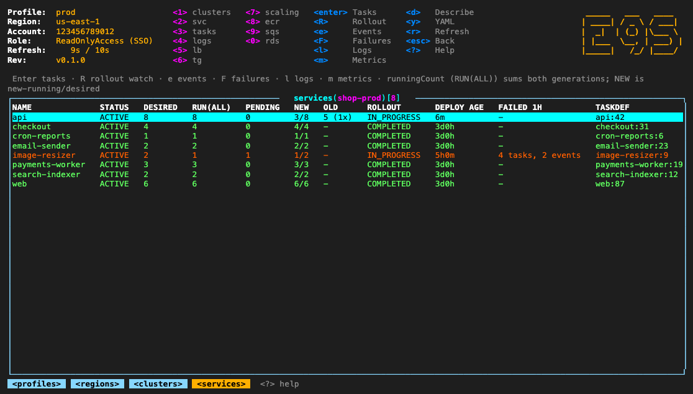
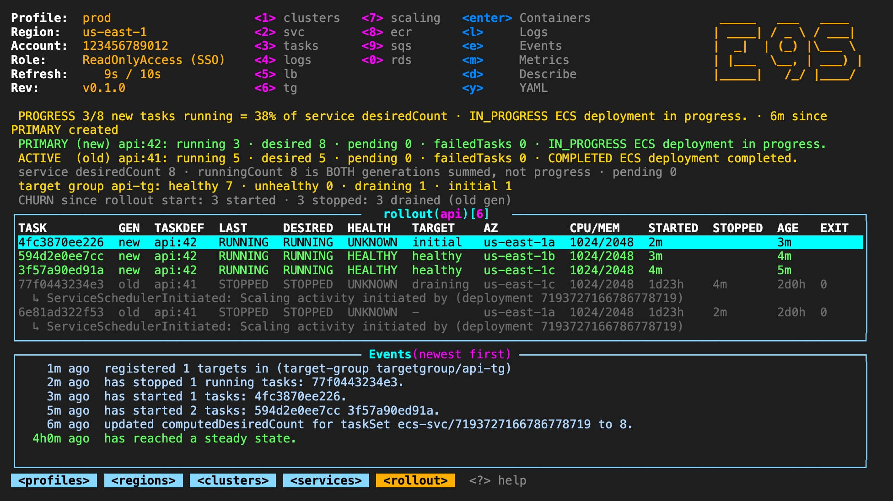
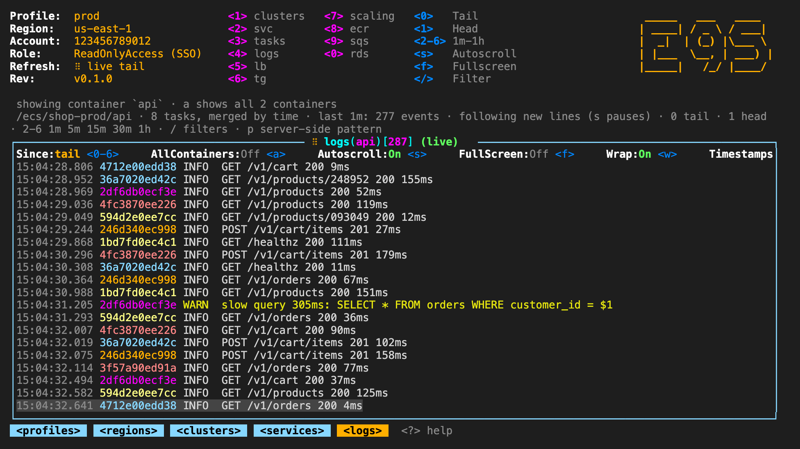
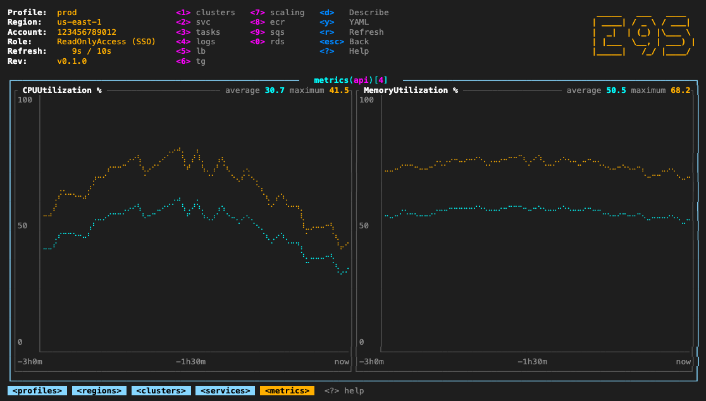
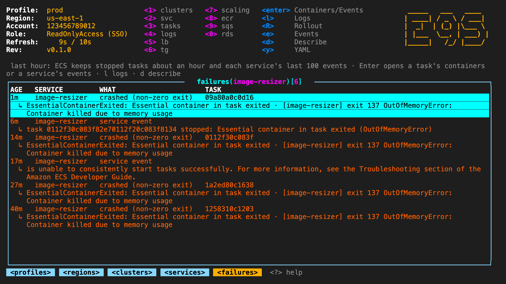
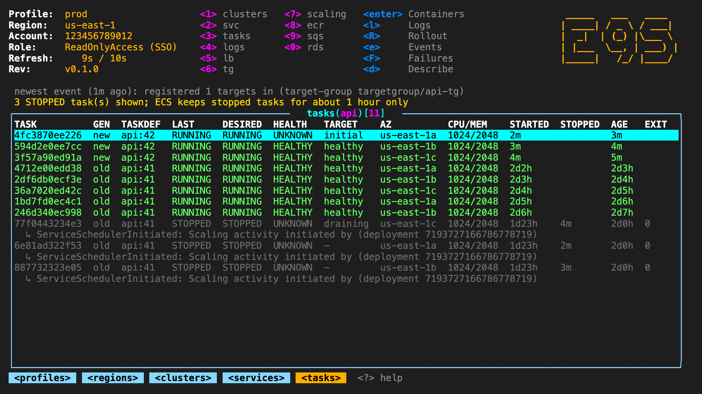

# e9s

A read-only, k9s-style terminal UI for AWS.
Browse ECS clusters, services, tasks and containers, read and live-tail their CloudWatch logs, and watch a deployment roll, with the same keys as k9s.

It cannot change anything.
Every AWS call goes through one function (`Aws::call` in `src/aws.rs`) that only lets through `describe-*`, `list-*` and `get-*` operations on an allowlist of services, plus `logs filter-log-events` and `cloudtrail lookup-events`.
Credential getters such as `ecr get-login-password` are refused too.
Environment variable and secret values are stripped from every response before they are shown or saved, so only their names appear.


## Screens

The recording and these screens come from `E9S_DEMO=1`, a made-up account (see Development).

| Services | Rollout watch (`R`) |
|---|---|
|  |  |
| **Live logs (`l`)** | **Metrics (`m`)** |
|  |  |
| **Failures (`F`)** | **Tasks** |
|  |  |

## Requirements

- AWS credentials as the AWS CLI uses them: e9s calls AWS through the official AWS SDK for Rust, which reads `~/.aws/config` and `~/.aws/credentials`, so SSO profiles, roles, credential processes and environment variables work as they do for the CLI. A profile you already logged in with `aws sso login` just works.
- The AWS CLI v2, only to log in from inside e9s (`L` runs `aws sso login`).
- A Rust toolchain, only to build from source.

## Install

```sh
brew install simion/tap/e9s   # macOS and Linux
cargo install e9s             # from crates.io: builds the AWS SDK, a few minutes
```

Binaries for macOS (Apple Silicon and Intel) and Linux (x86_64 and arm64) are on the [releases](https://github.com/simion/e9s/releases) page, with a shell installer.

From a checkout:

```sh
cargo install --path .     # builds a `e9s` binary into ~/.cargo/bin
```

Or, while working on the source:

```sh
make run ARGS="-p prod"    # build and launch
make install               # same as ./install.sh
./install.sh               # puts a `e9s` command in ~/.local/bin (BIN_DIR=/other/dir ./install.sh to choose)
./install.sh --uninstall   # removes it
```

The installed command is a small launcher that runs this checkout's source.
When any file under `src/`, `Cargo.toml` or `Cargo.lock` is newer than the built binary, it rebuilds first (seconds; the first build compiles the AWS SDK and takes a few minutes); otherwise it starts straight away.
So editing the source and running `e9s` again is all a change needs.

## Upgrade

At startup e9s asks GitHub for the latest release, as k9s does, in the background.
When there is a newer one, the header shows it next to `Rev:`, and quitting prints the command that upgrades your install: `brew upgrade e9s`, `cargo install e9s`, or the shell installer again.
e9s never installs anything itself.
`E9S_NO_UPGRADE_CHECK=1` turns the check off; builds from a checkout skip it.

## Run

```sh
e9s                                                    # pick a profile, then a region, then drill in
e9s -p prod                                            # skip the profile picker
e9s -p prod -r us-west-1                               # straight to clusters
e9s -p prod -r us-west-1 --cluster web                 # that cluster's services
e9s -p prod -r us-west-1 --cluster web -s api          # that service's tasks
e9s -p prod -r us-west-1 --cluster web -s api -c rollout   # its rollout watch
e9s -p prod -r us-west-1 -c 'logs /ecs/api ERROR'      # a log group, filtered
```

Every screen you can reach with the arrows and Enter can be opened from the command line, the way k9s takes `--context`, `-n` and `-c`.
The screens in between are stacked behind it, up to the region list and the profile picker, so Esc walks back up as if you had navigated there (for example `-c tasks` sits under clusters and the cluster's services, `-c 'logs <group>'` under log groups); each loads when you reach it.
Press `c` on any screen to copy the command that reopens it (or the nearest screen the command line can open, such as the task list above a container).

| Flag | Meaning |
|---|---|
| `-p`, `--profile NAME` | AWS profile (default: `AWS_PROFILE`, the only configured profile, or a picker) |
| `-a`, `--account ID` | The profile whose `sso_account_id` is `ID`; refuses and lists them if several match |
| `-r`, `--region REGION` | Region (default: the region scan). A cluster or command without a region uses the profile's region |
| `--cluster NAME` | Open this ECS cluster's services |
| `-s`, `--service NAME` | Open this service's tasks (needs `--cluster`) |
| `-c`, `--command CMD` | Open a view as if `:CMD` were typed inside: `-c rollout`, `-c tasks`, `-c 'logs <group> [pattern]'`, `-c sqs` |
| `--refresh SECONDS` | Auto-refresh interval; `0` turns it off (default 10) |
| `--headless` / `--logoless` / `--crumbsless` | Hide the header / the logo / the breadcrumbs |
| `--readonly` | Accepted so k9s habits and aliases work; e9s is always read-only. `--write` is refused |
| `-h`, `--help` | Usage |

Startup follows k9s: choose where you are, then navigate.

1. **Profile.** `--profile`, else `AWS_PROFILE`, else the only configured profile, else a picker over `~/.aws/config` and `~/.aws/credentials`. With no profiles at all it uses the default credential chain.
2. **Identity.** The header shows the profile, region, account and role. Below 120 columns or 30 rows it shrinks to two lines: that context on one, this screen's keys on the next (no logo or quick-view map; `?` lists them). A role whose name does not read as read-only is shown in yellow, as a reminder; e9s still only reads.
3. **Region.** Without `--region` it scans every enabled region in parallel and lists ECS clusters, services and running tasks per region, regions with resources first. Enter opens one.

Every way the AWS CLI signs in works, because the SDK reads the same files: IAM Identity Center (SSO, `sso_session` or the older per-profile settings), `aws login` console credentials (`login_session`), roles (`role_arn` with `source_profile` or `credential_source`), access keys, `credential_process`, web identity, environment variables and instance or container roles.
Roles that need an MFA code (`mfa_serial`) are not supported: the SDK cannot ask for the code.

The profile picker shows how each profile signs in (AUTH) and its LOGIN state (logged in, expired but renewing on use, not logged in), read from the same token cache file the SDK reads; a role shows the login of the profile it signs in through.
`L` logs in: the selected profile in the picker, or the current one elsewhere. It runs `aws sso login` (or `aws login`) for the profile that actually holds the login, so a role logs in its source profile. e9s steps aside while the CLI opens the browser (where an SSO session that is still signed in completes on its own), then comes back and reloads.
When credentials expire while e9s runs, it asks once whether to log in now (Enter) or later (Esc, then `L`); the header stays red until it works. Profiles with keys or `credential_process` have nothing to run: the header says to renew them and press `r`.

## Keys

| Key | Action |
|---|---|
| `:` | Command mode. Suggestions list under the prompt as you type; `↑` `↓` pick one, Tab completes |
| `ctrl-a` | Every command and its aliases; Enter opens one |
| `ctrl-z` | Faults, as in k9s: only rows that are not healthy (red or yellow), such as failed tasks, unhealthy targets or a service mid-rollout. Press again for every row |
| `/` | Filter rows live: regex, case-insensitive. `!re` inverts, `-f abc` is fuzzy (the letters in order). Enter keeps it, Esc clears it. In logs, matches are highlighted and the view stays at the newest line. In describe and YAML it searches instead: every line stays, matches are highlighted, `n` `N` jump to the next / previous |
| `Esc` | Clear the filter, else go back one level |
| `q` | Back one level; quits at the root |
| `ctrl-c` | Quit |
| `Enter` | Drill into the selected row |
| `j` `k` / `↑` `↓` | Move |
| `g` `G` / `Home` `End` | Top / bottom |
| `ctrl-f` `ctrl-b` / `PgDn` `PgUp` (also `ctrl-u`) | Page down / up |
| `ctrl-d` `ctrl-k` | Delete and kill in k9s; here they only say e9s is read-only |
| `d` | Describe, like `kubectl describe`: clusters, services (settings, rollout config, network, load balancers, deployments, events), tasks (stop reason, timeline, every container), containers and target groups (health check, every attribute) get a readable page; an RDS instance or cluster gets a live page (refreshed like a table) with pending changes as old -> new, how long the current change has been applying, pending maintenance, the last 24h of RDS events and the last 7 days of CloudTrail changes, to follow a modification step by step; a Lambda function gets a live page too, with its state, last update (updating, failed and why) and recent changes; anything else shows as YAML, and a structured log line is parsed first |
| `y` | YAML of the selection: the fields e9s reads from AWS, under their API names |
| `l` | Logs for the selection (service, task, container, log group, stream, Lambda) |
| `s` | Logs: autoscroll (follow new lines) on / off, on by default. Elsewhere `s` (shell in k9s) says e9s is read-only |
| `f` | Logs, describe and YAML: fullscreen, hiding the header and breadcrumbs |
| `F` | Failures of the last hour for the selected service, or the whole cluster where no service is selected |
| `p` | In a log view: set a CloudWatch filter pattern. In scaling targets: open the target's policies |
| `w` | Wrap long lines in logs and describe on or off (on by default) |
| `t` | Logs: show or hide timestamps |
| `0` `1` `2`-`6` | Logs, as in k9s: start from the newest lines (tail, the default), from the first lines (head, not followed), or 1m, 5m, 15m, 30m, 1h back. A window reads up to 5000 lines per 100 streams and says when it was cut |
| `a` | Service logs: every container of each task that logs to the same group, tagged `container/task` |
| `m` / `C` / `c` | Logs: draw a mark line across the view / clear the screen (following continues) / copy the lines shown (after the filter) |
| `ctrl-s` | Save the current view (after filter and sort) to `~/Downloads`. Logs save as a `.log` with full timestamps and task ids, including every line tailed so far (the view keeps the last 50,000) |
| `R` | Rollout watch for the selected service (see below) |
| `e` | Events of the selected service, newest first, untruncated |
| `m` | CloudWatch metrics for the selected service, load balancer, target group, RDS instance or cluster (CPU, connections, free storage and memory, latency) or Lambda function (invocations, errors, throttles, duration p95, concurrency) |
| `T` | Who changed it: CloudTrail write events of the selected RDS, Lambda or EC2 resource, last 7 days. Also from their `d` page |
| `r` / `ctrl-r` | Refresh now (also re-checks identity after an SSO login) |
| `c` | Copy the command line that reopens this view (pbcopy, wl-copy or xclip). In logs `c` copies the lines instead, and in describe and YAML the page, as in k9s |
| `+` | Auto-refresh interval: off, 5, 10, 15, 30, 60 seconds, then off again. The header shows the countdown |
| `[` `]` `-` | As in k9s: back and forward through the commands typed after `:`, and back to the one before |
| `<` `>` | Sort by the previous / next column |
| `o` | Reverse the sort |
| `N` `A` `S` | Sort by name / by the AGE column / by the status column (STATUS, LAST or STATE); press again to reverse |
| `ctrl-e` `ctrl-g` | Hide or show the header / the breadcrumbs, as in k9s (`--headless` and `--crumbsless` start with them hidden) |
| `0`-`9` | Quick views: 1 clusters, 2 services, 3 tasks, 4 log groups, 5 load balancers, 6 target groups, 7 scaling, 8 ECR, 9 SQS, 0 RDS |
| `?` | Help overlay: what the current screen is in AWS terms and its Kubernetes equivalent, then every key and command. Scroll with `↑` `↓` / `j` `k`, page with `PgUp` `PgDn` / `space`, close with `Esc`, `q` or `?` |
| `L` | Log in (`aws sso login` or `aws login`): the selected profile in the profile picker, else the current one; a role logs in through its source profile |
| `H` | Command log for this screen: every AWS call it made, written as the equivalent `aws` CLI command, running first, then newest first, with how long ago it started, how long it took, and a tick or a cross for its result. While a screen loads, finished calls stay listed under the running ones |

## Commands

| Command | View |
|---|---|
| `:clusters` `:cl` `:ecs` `:ns` | ECS clusters |
| `:services` `:svc` `:deploy` `:dp` `[cluster]` | Services of a cluster (default: the one you last opened) |
| `:tasks` `:task` `:po` `[cluster]` | All tasks of a cluster, running and recently stopped |
| `:events` `:ev` | Events of the current service |
| `:rollout` `:ro` | Rollout watch of the current service |
| `:failures` `:fail` | Failed tasks and problem service events of the last hour, whole cluster (`-c failures` with `-s` for one service) |
| `:taskdefs` `:td` | Task definition families, then revisions, then containers |
| `:logs` `:lg` | Log groups; `:logs <group> [filter pattern]` opens events directly |
| `:lb` `:alb` `:elb` `:ing` | Load balancers, then target groups, then targets |
| `:tg` `:targetgroups` | All target groups |
| `:scaling` `:as` `:hpa` `[namespace]` | Application Auto Scaling targets (default namespace `ecs`) |
| `:policies` `:pol` `[namespace]` | Scaling policies |
| `:activities` `:act` `[namespace]` | Scaling activities |
| `:ec2` `:no` `:nodes` | EC2 instances |
| `:ecr` | ECR repositories, then images |
| `:sqs` | SQS queues with depth, in-flight, oldest message age and DLQ |
| `:rds` | RDS clusters and instances, with writer / reader roles and a PENDING column (queued or applying changes, old -> new) |
| `:lambda` `:fn` | Lambda functions, with ERRORS 1H and THROTTLES 1H, and STATUS (updating, ready, failed) for those changed in the last 15 minutes |
| `:pulse` `:pu` `:overview` | Everything not healthy on one screen: alarms firing, ECS services (every cluster) failing or rolling, RDS not available or changing, Lambda failing, updating or throttled. Enter opens it |
| `:alarms` `:al` | CloudWatch alarms, firing first, with condition, actions and why. Target-tracking scaling alarms are dimmed at the bottom (their ALARM drives scale-in). Enter opens the resource the alarm watches |
| `:trail` `:ct` `[name]` | CloudTrail write events of the last 24h: who, what, which resource, and the error if it failed; `d` shows the call with secrets redacted. With a name, that resource's last 7 days |
| `:access` `:can` | Each read e9s makes, tried once with this profile: allowed or denied, and which view it feeds |
| `:profile` `:ctx` `[name]` | Profile picker, or switch to a profile |
| `:region` `:regions` `[name]` | Region scan, or switch to a region |
| `:quit` `:q` | Quit |

The Kubernetes aliases (`:ns`, `:deploy`, `:po`, `:hpa`, `:no`, `:ing`) open the nearest AWS view, so k9s habits land somewhere sensible.
`:svc` stays ECS services, not load balancers.

## The drill-down chain

The k9s path from deployments to pods to containers to logs maps to:

`regions` › `clusters` › `services` › `tasks` › `containers` › `l` logs

- **Services** tag each service with `FAILED 1H`: its failed task stops (failed health check, failed start, crash) and problem service events of the last hour. A tagged service is red; `F` lists what failed.
- **Services** split each service by deployment generation. `NEW` is new-generation running tasks over the service's `desiredCount`; `OLD` is what the old generation still runs. `RUN(ALL)` is ECS's `runningCount`, the sum of both generations, so it is never rollout progress.
- **Tasks** list RUNNING and STOPPED tasks together. Each shows its generation (`new` / `old`), task definition revision, AZ, reserved CPU/memory, start, stop and age, its target group state, and a `REASON` column built from the task's `stopCode` and `stoppedReason`, each container's exit code, reason and health, the target's health reason, and the matching "is unhealthy in target-group" service event.
- ECS keeps stopped tasks for only about an hour; the view says so instead of showing an empty list as if nothing failed.

Colours follow k9s: green steady, yellow transitioning, red failed, grey finished normally.
A stopped task is classified by why it stopped. An old-generation task drained by the scheduler ("Scaling activity initiated by deployment ...") is a normal drain and is grey, even with exit code 137 or 143. A failed ELB health check, a failed start, or a non-zero exit outside a drain is red.

## Rollout watch (`R`)

For one service, refreshing on the interval:

- **Progress**: new-generation running over the service `desiredCount`, as a count and a percentage. The PRIMARY deployment's own `desiredCount` is shown separately, since ECS ramps it during the roll.
- **Generations**: PRIMARY (new) and every ACTIVE (old) with running, desired, pending, `failedTasks`, `rolloutState` and its reason.
- **Target groups**: healthy, unhealthy, draining and initial counts, so a fleet that reads short because tasks are draining is visible as such.
- **Churn**: tasks started and stopped since the PRIMARY deployment was created, with stops broken down, for example `48 drained (old gen), 1 failed health check`. A roll that keeps replacing tasks looks different from one waiting on a long deregistration delay.
- **Elapsed** time since the PRIMARY deployment was created.
- **Tasks**: every PRIMARY task and every task stopped since the rollout began, failures first.
- **Events**: the service's event stream in its own pane, newest first, never truncated.

## Loading

Every view fetches in the background.
A spinner in a fixed slot (the `Status:` row and the table title) turns while anything loads, so nothing on screen shifts.
An empty view lists its AWS calls as they run, with their elapsed time, for example `aws ecs list-clusters --region us-west-1  0.8s`; finished calls stay listed below the running ones with a tick or a cross, and `H` shows the screen's whole command log.
A refresh over rows already on screen names the call in flight at the bottom.
Long argument lists are shortened for display only (`--tasks 1a2b… (+99)`, ARNs to their last segment, JSON to `<json>`).

## Failures are loud

A failed call never renders as an empty or healthy list.

- A failed refresh shows `REFRESH FAILED` above the table, and says when the rows below are from the last successful refresh.
- When one batch of a multi-call fetch fails, the rows that did load are shown under a red "list INCOMPLETE" note naming the call and the error.
- `failures[]` returned inside successful ECS responses are surfaced the same way.
- Truncated results (log streams, scaling activities, log events over the cap) say so.
- Table cells, notes and events wrap instead of being cut.

## Logs

`l` resolves the CloudWatch target from the task definition's `awslogs` configuration: the stream `<prefix>/<container>/<task-id>` for a task or container.
For a service it names the stream of every running task, so lines from all tasks are merged by time and each is tagged with its task id in its own colour, as k9s does for pods.
Streams go 100 to a `filter-log-events` call (the API's limit), and the calls run in parallel.
The service's stream prefix alone would also match every stream it ever had (10,000 for a busy service), which made each read take about 18 s instead of about 2.5 s.

It opens on the newest lines: one stream reads its tail directly; several streams take one call to measure the rate, then fetch the last few seconds' worth (about 1000 lines).
Then it follows: every 2 s it reads what arrived since the newest line shown, re-reading 5 s back for lines CloudWatch ingests late and dropping ones already shown.
If more lines arrive between two reads than one read returns (10,000 per batch), it says so and jumps to now.
`s` pauses and resumes.
This polls `filter-log-events` instead of using StartLiveTail, because Live Tail is billed per minute and the polled lines already carry their stream.

## Development

```sh
cargo test        # guard, 10-service and 100-task chunking, 100-stream log batches, failure surfacing, generation split, redaction
```

`--script "<tokens>"` drives the real app on an in-memory screen and prints it, for checks without a terminal:

```sh
e9s -p prod -r us-west-1 --cluster my-cluster --script "@wait @snap"
```

Tokens: `@wait` (until the view has loaded; prints the load time to stderr), `@sleep` (2 s), `@snap` (print the screen), `@shot=<path>` (write the screen as HTML), `@size=WxH` (resize the screen, 200x60 by default), `@cmd` (print the launch command `c` would copy), `<Enter>` `<Esc>` `<Tab>` `<Space>` `<C-x>`; anything else is typed as keys.

`E9S_DEMO=1` answers every read from a made-up account instead of AWS (`src/demo.rs`: one cluster mid-rollout, one service running out of memory, logs that keep coming).
The recording and screenshots above come from it, and `make demo` makes them again in about 2 minutes: `docs/demo/screens.sh` draws `docs/screens` with `--script` and headless Chrome, then [vhs](https://github.com/charmbracelet/vhs) records `docs/demo.gif` from `docs/demo/demo.tape` (a real terminal running plain `e9s`).
`HOME` is `docs/demo/home` during both, so the profiles and their SSO login are made up too.

Layout: `src/aws.rs` is the read-only guard, `src/sdk.rs` the AWS SDK transport, `src/views.rs` every resource view (fetch, columns, health, drill-down), `src/logic.rs` pure helpers (deployment split, redaction, sorting, time), `src/app.rs` state and keys, `src/ui.rs` rendering.

## License

MIT, see [LICENSE](LICENSE).
